 

I'm **aiwren** (**捣鼓熊**), an independent developer building **quiet, tactile, local-first software**. I prefer tools where computation and AI inference run directly on your own device rather than in someone else's cloud — no mandatory accounts, no telemetry walls, and your data stays in your hands.

- 🏠 **Personal Studio & Notes**: [tinkerai.cn](https://tinkerai.cn)
- ✨ **FleetingGleam Official Site**: [gleam.tinkerai.cn](https://gleam.tinkerai.cn/)

### What I'm Building

- **[FleetingGleam (惊鸿)](https://github.com/aiwren/FleetingGleam)** — Open-source, on-device photo culling for **macOS (Apple Silicon)** and **Android**. Automatically groups burst shots from the same moment, ranks candidates with explainable multi-metric scoring, pairs RAW + JPEG files, supports natural-language photo search, and connects directly to home NAS shares over SMB. Built with `Rust`, `Tauri 2`, `Swift`, and `Kotlin`.
- **[ClassDesk (老师工作台)](https://tinkerai.cn/works/classdesk/)** — A multi-platform workspace for homeroom teachers' daily workflows: mobile attendance and homework tracking in `Flutter`, a pure-JS grid detector + lightweight 40×40 CNN that reads hand-marked paper homework sheets in milliseconds, on-device `PP-OCRv6` timetable parsing, and an `Electron` classroom display client.
- **[TinkerAI Window Studio (窗边工作间)](https://tinkerai.cn/works/window-room/)** — My personal website at [tinkerai.cn](https://tinkerai.cn): an isometric 3D studio built in `Blender` and distilled from a 26 MB scene into a 49 KB interactive first frame using camera ray-cast SVG contours and localized WebP motion strips.

---

<b>🇨🇳 中文介绍 (Chinese Introduction)</b>

 

我是**捣鼓熊 (aiwren)**，平时喜欢做一些**顺手、安静、本地优先（Local-First）**的软件工具：能放在设备端本地跑通的计算与模型推理，就不依赖云端上传；没有多余的账号墙，数据始终留在用户自己手里。

- **[惊鸿 · FleetingGleam](https://github.com/aiwren/FleetingGleam)**（[中文官网](https://gleam.tinkerai.cn/zh/)）：运行在 Mac 与安卓手机上的开源本地照片筛选软件，把几千张照片里同一瞬间的连拍自动分组、多维可解释评分并标出最佳候选，支持中英文自然语言搜图与直连家庭 NAS。
- **[老师工作台 · ClassDesk](https://tinkerai.cn/works/classdesk/)**：面向班主任日常工作的多端工作台，包含纯 JS 40×40 轻量卷积网络识别纸质作业登记表、端侧 PP-OCRv6 课表截图识别、教室大屏通知客户端与扫码授权 MCP 助手。
- **[窗边工作间 · tinkerai.cn](https://tinkerai.cn)**：用 Blender 搭一间窗边小屋，通过相机射线拾取精确 SVG 轮廓与局部动作图条，把 26 MB 场景浓缩成 49 KB 的可交互个人主页（[阅读桌边技术手记 →](https://tinkerai.cn/notes/)）。

