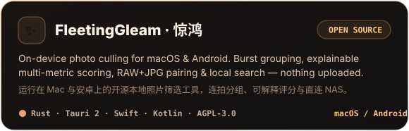
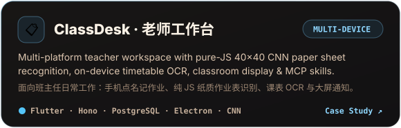
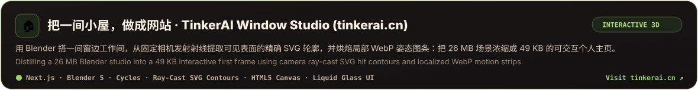

 

<!-- Quick Navigation & Live Status Badges -->

  
  
  
  
  

  <a href="#-嗨我是捣鼓熊-aiwren"><b>🇨🇳 中文介绍</b></a> ·
  <a href="#-hi-im-aiwren-tinkerbear"><b>🌐 English Bio</b></a> ·
  <a href="#-正在维护的作品--featured-projects"><b>🛠️ 作品 / Projects</b></a> ·
  <a href="#-桌边技术手记--engineering-notes"><b>📓 手记 / Notes</b></a> ·
  <a href="#-常用技术栈--tech-stack"><b>🧰 技术栈 / Stack</b></a>

---

## 🛠️ 正在维护的作品 / Featured Projects

<table>
  <tr>
    <td width="50%" align="center">
      
    </td>
    <td width="50%" align="center">
      
    </td>
  </tr>
  <tr>
    <td colspan="2" align="center">
      
    </td>
  </tr>
</table>

---

<table>
  <tr>
    <td width="46%" valign="middle" align="center">
      
      👆 点击进入 <a href="https://tinkerai.cn"><b>tinkerai.cn</b></a>：桌上的显示器、笔记本、相框、机械键盘、人体工学椅、斗柜与车模架均可直接交互
    </td>
    <td width="54%" valign="top">
      <h3 id="-嗨我是捣鼓熊-aiwren">🇨🇳 嗨，我是捣鼓熊 (aiwren)</h3>
      

        平时喜欢做一些<b>顺手、安静、本地优先（Local-First &amp; On-Device）</b>的软件工具：能放在设备端本地跑通的计算与模型推理，就不依赖云端上传；没有多余的账号墙，数据始终留在用户自己手里。
      

      <ul>
        <li><b>惊鸿 FleetingGleam</b>：Mac 与 Android 开源本地选片软件，连拍分组、多维可解释评分、中英文自然语言搜图、直连家庭 NAS（<a href="https://gleam.tinkerai.cn/zh/">中文官网</a> · <a href="https://github.com/aiwren/FleetingGleam">GitHub</a>）。</li>
        <li><b>老师工作台 ClassDesk</b>：班主任多端日常工作台，包含纯 JS 40×40 卷积网络纸质作业表识别、端侧 PP-OCRv6 课表识别与扫码授权 MCP 助手（<a href="https://tinkerai.cn/works/classdesk/">作品详情</a>）。</li>
        <li><b>窗边工作间</b>：把 26 MB Blender 场景浓缩成 49 KB 首图与局部微动效的个人网站（<a href="https://tinkerai.cn">进入小屋</a>）。</li>
      </ul>
      

      <h3 id="-hi-im-aiwren-tinkerbear">🌐 Hi, I'm aiwren (TinkerBear)</h3>
      

        I build <b>quiet, tactile, local-first software</b> — tools where computation and AI inference run directly on your own device rather than in someone else's cloud. No mandatory accounts, no telemetry walls, and your data stays yours.
      

      <ul>
        <li><b>FleetingGleam (惊鸿)</b>: Open-source on-device photo culling for macOS &amp; Android with burst grouping, explainable multi-metric scoring, RAW+JPG pairing &amp; local semantic search (<a href="https://gleam.tinkerai.cn/">Website</a> · <a href="https://github.com/aiwren/FleetingGleam">GitHub</a>).</li>
        <li><b>ClassDesk (老师工作台)</b>: Multi-platform teacher workspace featuring a pure-JS 40×40 CNN paper sheet reader, on-device OCR &amp; QR-authorized MCP skills (<a href="https://tinkerai.cn/works/classdesk/">Overview</a>).</li>
        <li><b>TinkerAI Window Studio</b>: An isometric 3D Blender room distilled into a 49 KB interactive homepage (<a href="https://tinkerai.cn">Visit Studio</a>).</li>
      </ul>
    </td>
  </tr>
</table>

---

## 📓 桌边技术手记 / Engineering Notes

| 领域 / Topic | 手记标题 / Note (点击阅读) | 核心实践 / Key Takeaway |
| :--- | :--- | :--- |
| 🧠 **识别引擎** On-Device Vision | **[不靠大模型，用纯 JS 认一张纸质作业登记表](https://tinkerai.cn/notes/homework-sheet-ocr/)** Reading Paper Homework Sheets in Pure JS Without LLMs | JPEG DCT 域缩放 + 透视网格切格 + 轻量 40×40 卷积网络，在普通 Node 服务端几百毫秒完成整表识别 |
| 🎯 **射线拾取** Ray-Cast SVG | **[沿着显示器找边界](https://tinkerai.cn/notes/visible-outline/)** Tracing Visible Outlines Along the Monitor | 从 Blender 正交相机向场景发射射线，扣除前方摆件遮挡，生成严丝合缝的 SVG 可点击轮廓 |
| ⚡ **性能取舍** First-Frame Budget | **[为什么首屏不搬来整个 3D 模型](https://tinkerai.cn/notes/light-first-frame/)** Why the First Frame Doesn't Ship a 26 MB 3D Model | 26 MB 压缩 3D 模型 vs. 49 KB 静态首屏 WebP + 按需加载局部骨骼关键帧图条 |
| 🪟 **渐进增强** Progressive Web | **[抽屉里的文章，也要有门牌号](https://tinkerai.cn/notes/real-links/)** Every Drawer Article Deserves Its Own URL | 左侧液态玻璃阅读抽屉、独立双栏静态页面与浏览器 History 后退栈的一致协同 |
| 📸 **交互细节** UX & Workflow | **[一批照片判错了，怎么撤回？](https://tinkerai.cn/notes/gleam-batch-undo/)** Batch Culling and Atomic Batch Undo in FleetingGleam | 惊鸿 Android 端长按多选批量判定（保留 / 待定 / 淘汰）与按批原子撤销流程 |

---

## 🧰 常用技术栈 / Tech Stack

  

- **桌面与系统层 / Desktop & Systems**  
  
  
  
  

- **移动与跨端 / Mobile & Cross-Platform**  
  
  
  
  
  

- **Web 与服务端 / Web & Backend**  
  
  
  
  
  
  
  
  

- **端侧推理与 3D 图形 / On-Device AI & 3D Graphics**  
  
  
  
  
  

---

🏠 <b>捣鼓熊的小屋 · TinkerAI Studio</b> — <a href="https://tinkerai.cn">tinkerai.cn</a> · <a href="https://gleam.tinkerai.cn/zh/">gleam.tinkerai.cn</a>

